# bombe_7segment_01
Cet objet simule une bombe avec un afficheur 4 x 7 segments et des fils qui permettent de neutraliser la bombe ou au contraire la faire exploser. Le nombre de fils et leur réactions sont configurables, ainsi que plusieurs autres paramètres tel que le temps initial ou la rapidité du décompte. Le paramétrage se fait via un back office accessible via le wifi. l'explosion est simulée par l'afficheur et le buzzer

**[Exemple](#Exemple)** 
**[Composants](#Composants)**  
**[Branchements](#Branchements)**  
**[Installation du firmware](#Installation-du-firmware)**  
**[Mode d’emploi](#)**   
**[Fils de désamorçage](#)**   
**[Back Office](#BackOffice)**  
**[Paramètres de gameplay](#param%C3%A8tres-de-gameplay)**  
**[Paramètres Réseau](#param%C3%A8tres-r%C3%A9seau)** 

## Exemple
Un exemple du kit technoLARP monté pour une bombe_7segment_01

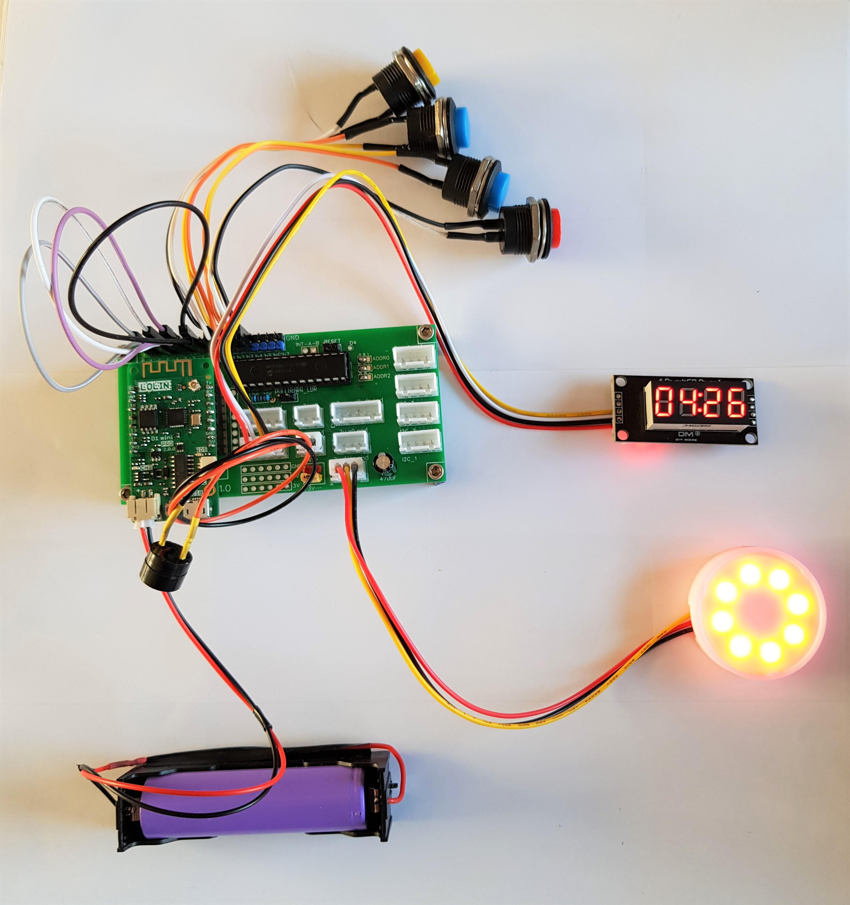

Voici un exemple de casing plus avancé

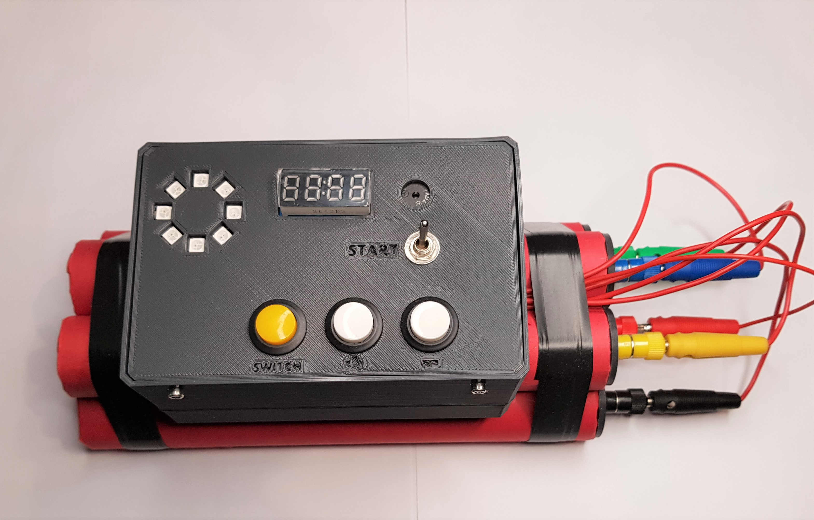

## Composants
Vous aurez besoin pour monter la bombe_7segment_01

|  | |
| :---------------- | :------: |
| Un kit technoLarp | 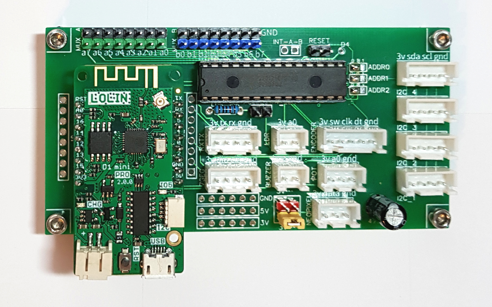 |
| Un câble micro-USB | 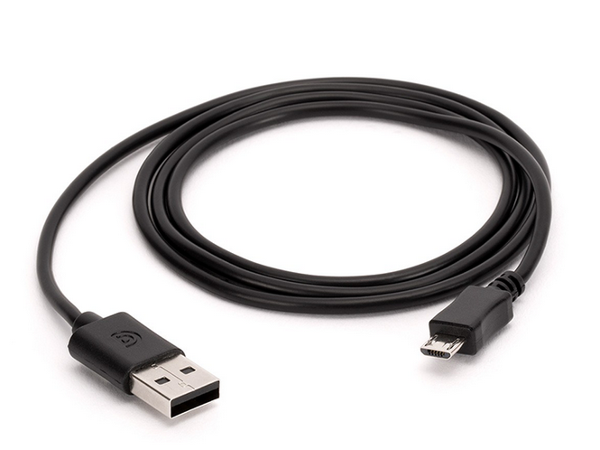 |
| Un ruban ou d’un anneau de led ws2812b ou neopixel | 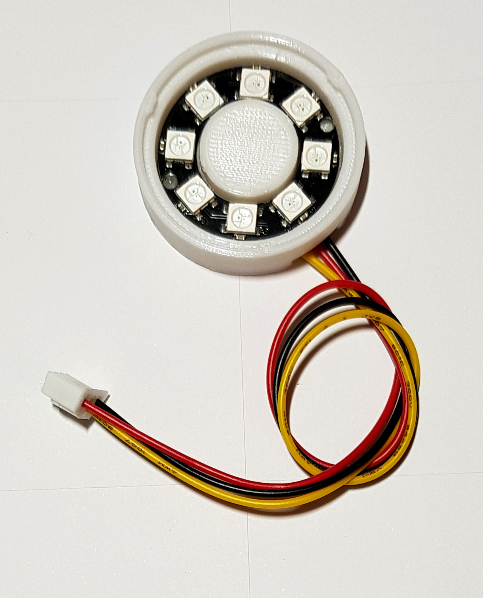 |
| Un afficheur 4 * 7 segments | 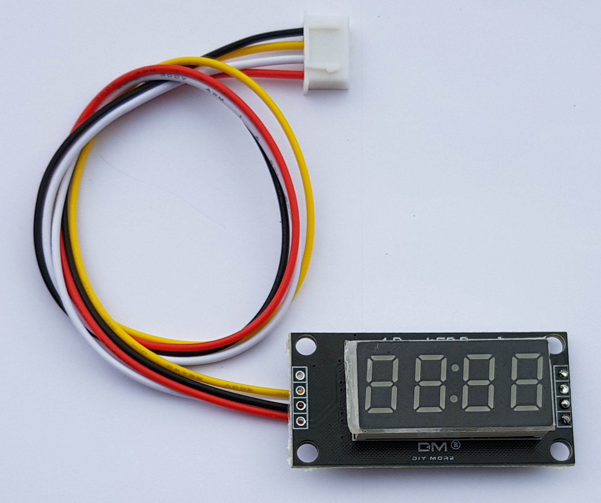 |
| 4 boutons poussoirs | 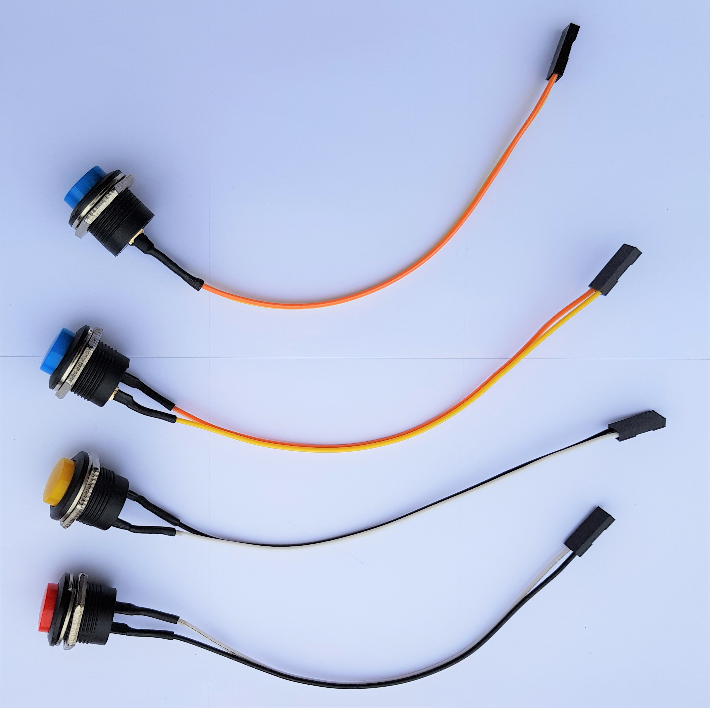 |
| Un buzzer piezo | 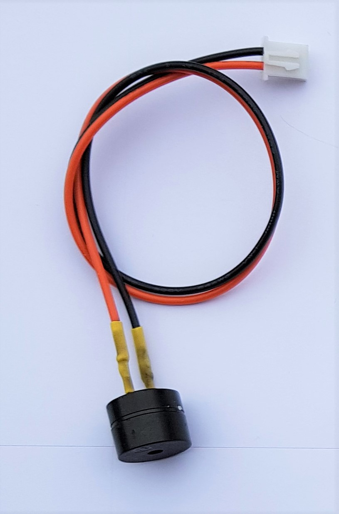 |
| Une batterie 18650 et son support | 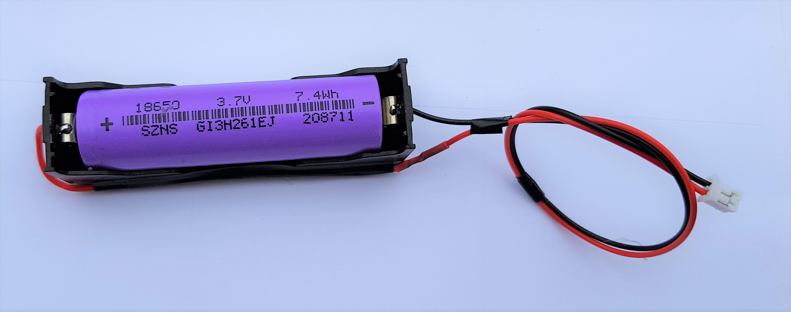 |

## Branchements
Connecter les composants sur le kit technoLARP comme sur cette photo

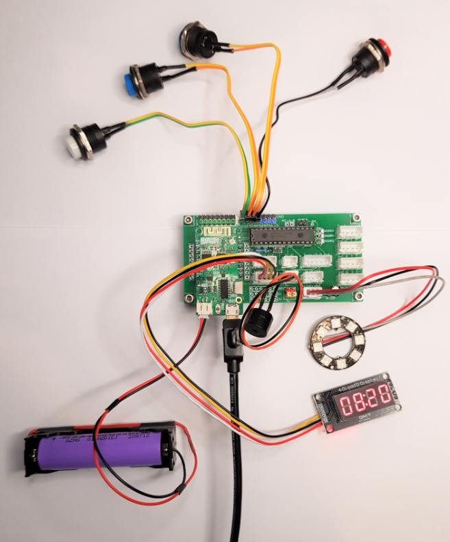

 - Branchez le ruban ou anneau led ws2812b sur le port "leds ws2812b"
 - Branchez le buzzer sur son port "buzzer"
 - Branchez l'afficheur 4 * 7 segments sur le port I2C_1
 - Branchez les 4 boutons poussoirs sur les broches du MCP23017 numérotées b0 à b3
 - Branchez les fils de désamorçage sur les broches a0 à a7 (et sur la masse GND)
 
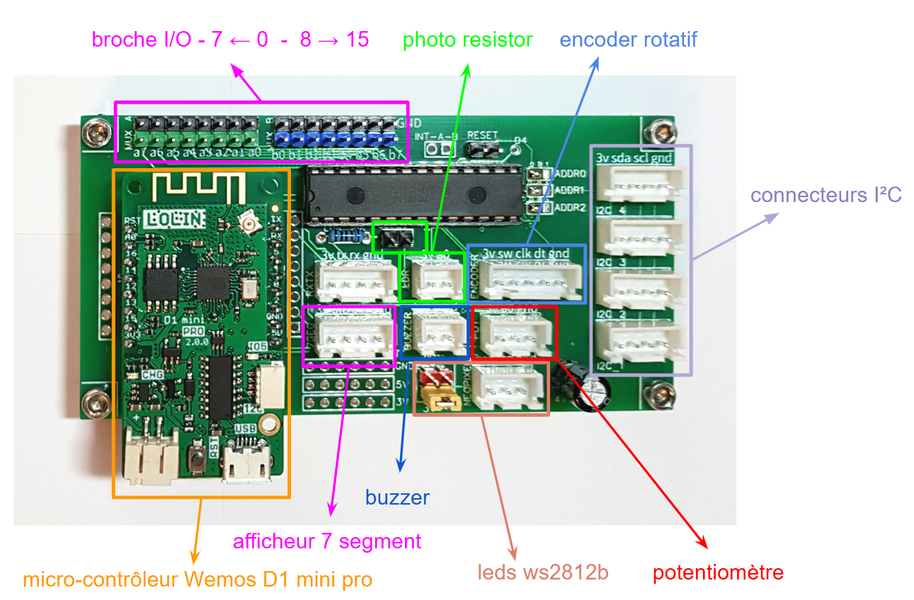

### Boutons poussoirs

Les 4 boutons poussoirs se connectent ainsi :

| bouton poussoir MINUTES / SECONDES | b0 |
| :---- | :---- |
| bouton poussoir PLUS | b1 |
| bouton poussoir MOINS | b2 |
| bouton poussoir ACTIVATION | b3 |

Attention au sens de numérotation des broches :

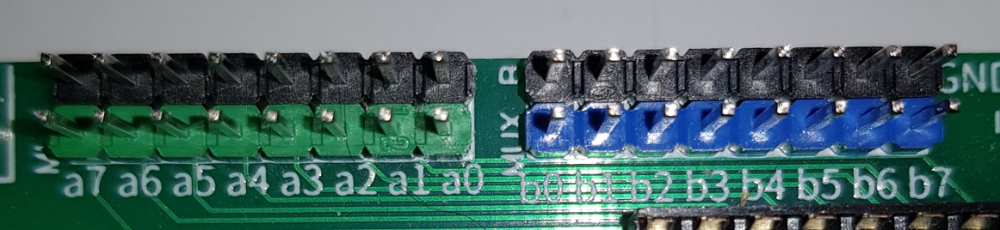

| a7    <====    a0 | b0   ====>     b7 |
| :---: | :---: |

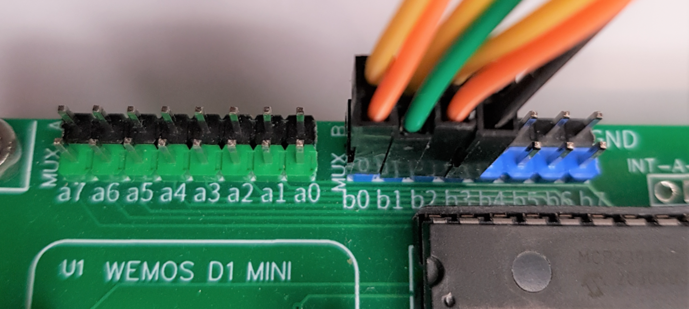

## Installation du firmware
Pour installer le firmware de l'objet, il faut suivre ce [tutorial](https://github.com/technolarp/technolarp.github.io/wiki/Installation-du-firmware)  

## Mode d’emploi

Une fois la bombe mise sous tension par batterie ou câble USB, elle se place dans un état ALLUMEE qui permet à l'utilisateur de configurer le temps avant l'explosion.

* bouton poussoir MINUTES / SECONDES permet de changer soit les minutes, soit les secondes
* bouton poussoir PLUS permet d'augmenter les minutes ou les secondes de 1
* bouton poussoir MOINS permet de diminuer les minutes ou les secondes de 1
* bouton poussoir ACTIVATION passe la bombe en mode ACTIVE. Dès lors, les boutons ne servent plus. La bombe commence à décompter le temps jusqu'à 0 puis explose. Cette explosion est simulée par les leds qui clignotent en rouge rapidement, par l'afficheur qui clignote avec le message " B O O M" et le buzzer qui beep en continu pendant 5 secondes.

## Fils de désamorçage

Il est possible d'ajouter des fils de désamorçage pour rendre la bombe plus interactive. Il peut y avoir jusqu'à 8 fils de désamorçage. Un fil sera connecté sur une des broches a0 à a7 (broches vertes) d'un côté, et sur la masse (GND), c'est-à-dire les broches noires juste au-dessus des broches vertes.

Exemple avec 4 fils de désamorçage :

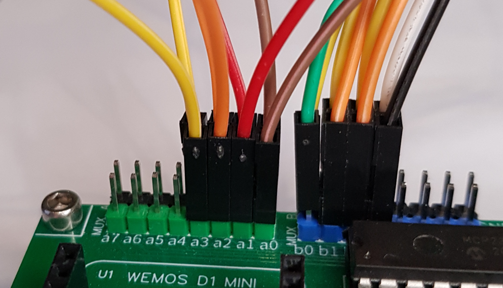

L'ordre des fils est fixé :

| Fil n° 01 | broche a0 |
| :---- | :---- |
| Fil n° 02 | broche a1 |
| Fil n° 03 | broche a2 |
| Fil n° 04 | broche a3 |
| Fil n° 05 | broche a4 |
| Fil n° 06 | broche a5 |
| Fil n° 07 | broche a6 |
| Fil n° 08 | broche a7 |

Cet exemple montre fil n°4 (jaune) qui a été déconnecté. Cela permet de “couper” un fil et de pouvoir le réutiliser plus tard.

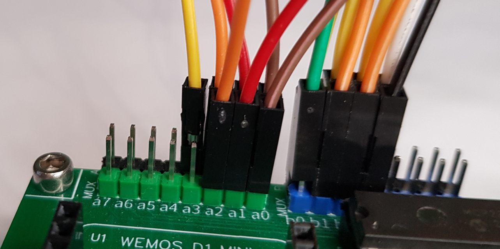

## BackOffice
Pour se connecter au back office de l'objet, il faut suivre ce [tutorial](https://github.com/technolarp/technolarp.github.io/wiki/Connexion-au-back-office-de-l'objet-via-le-wifi)  

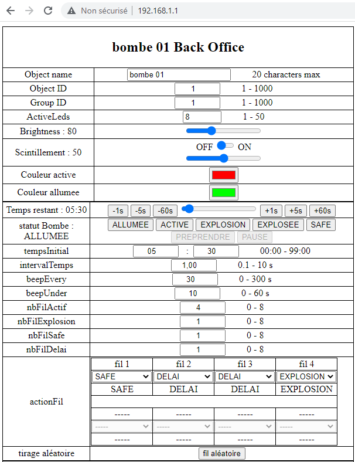

## Paramètres de gameplay
Ces paramètres permettent de contrôler le gameplay de l’objet.

| Nom                           | Descriptif                                                                                                                                                                       |
|-------------------------------|----------------------------------------------------------------------------------------------------------------------------------------------------------------------------------|
| **Object name**               | Le nom de l'objet, composé de 1 à 20 lettres et chiffres                                                                                                                         |
| **Object ID**                 | Un numéro d’identification de l’objet                                                                                                                                            |
| **Group ID**                  | Un numéro d’identification du groupe de l’objet                                                                                                                                  |
| **ActiveLeds**                | Le nombre total de leds utilisées par la bombe. entre 1 et 25                                                                                                                    |
| **Brightness**                | La luminosité des leds, entre 0 (éteinte) et 255 (pleine intensité)                                                                                                              |
| **Scintillement**             | Le scintillement permet d’activer le scintillement des leds pour un effet visuel plus ou moins rapide. le slider permet de régler la vitesse du scintillement                    |
| **Couleur active**            | Choix de la couleur quand la bombe est en mode ACTIVE                                                                                                                            |
| **Couleur allumee**           | Choix de la couleur quand la bombe est en mode ALLUMEE                                                                                                                           |
| **Temps restant**             | Le temps restant avant l'explosion. Entre 00:00 et 99:00 Les boutons permettent d'ajouter ou de retirer du temps Le slider permet de changer le temps restant                   |
| **statut Bombe**              | Le statut actuel de la bombe. Les boutons permettent de changer le statut de la bombe manuellement                                                                              |
| **tempsInitial**              | le temps qui sera affiché quand la bombe s'allume et passe en mode ALLUMEE. Entre 00:00 et 99:00                                                                                  |
| **intervalTemps**             | Le facteur d’accélération du temps 1.0 équivaut à exactement 1 seconde en dessous de 1.0, le temps s’écoule plus rapidement au dessus de 1.0, le temps s’écoule plus lentement   |
| **beepEvery**                 | La bombe émet un beep court toutes les X secondes                                                                                                                                |
| **beepUnder**                 | La bombe émet un beep court toutes les secondes quand le temps restant passe sous Y secondes                                                                                     |
| **nbFilActif**                | Le nombre de fil de désamorçage. Entre 0 et 8 Si nbFilActif est supérieur ou égal à 1, un nombre équivalent de fils doit être connecté sur les broches a0 à a7. Voir le chapitre "Fils de désamorçage" |
| **actionFil**                 | Chaque fils de désamorçage a un statut NEUTRE, statut par défaut. Ce fil n’a aucun effet sur la bombe SAFE, ce fil désamorce la bombe DELAI, ce fil accélère le décompte EXPLOSION, ce fil fait exploser la bombe ALEATOIRE, l’action de ce fil sera choisie aléatoirement par la bombe au moment de l’activation COUPE, ce fil a déjà été coupé |
| **tirage aléatoire**          | Ce bouton permet de réaffecter l’action des fils aléatoires                                                                                                                     |
| **nbFilExplosion**            | Le nombre de fils aléatoires qui feront exploser la bombe s’ils sont coupés                                                                                                     |
| **nbFilSafe**                 | Le nombre de fils aléatoires qui désamorcent la bombe s’ils sont coupés                                                                                                         |
| **nbFilDelai**                | Le nombre de fils aléatoires qui amélioreront le décompte du temps s’ils sont coupés                                                                                             |

### Fils aléatoires

Si un fil est paramétré avec une de ces actions, ce fil ne sera pas affecté par les actions aléatoires :
NEUTRE, SAFE, DELAI, EXPLOSION

Si un ou plusieurs fils sont paramétrés en action ALEATOIRE, alors la bombe affecte les actions dans cet ordre, en fonction des paramètres nbFilExplosion, nbFilSafe et nbFilDelai :
* 1 - EXPLOSION
* 2 - SAFE
* 3 - DELAI

## Paramètres Réseau

Pour avoir le descriptif des paramètres réseau suivez ce [lien](https://github.com/technolarp/technolarp.github.io/wiki/Param%C3%A8tres-R%C3%A9seau)  
